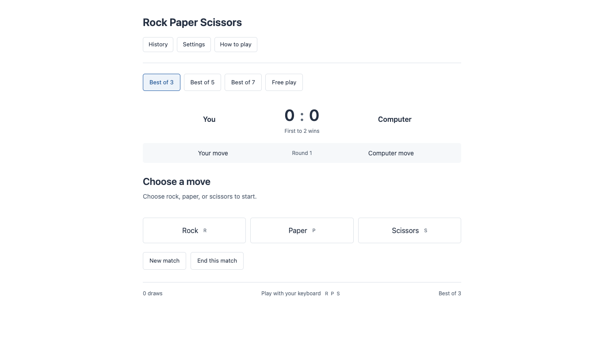
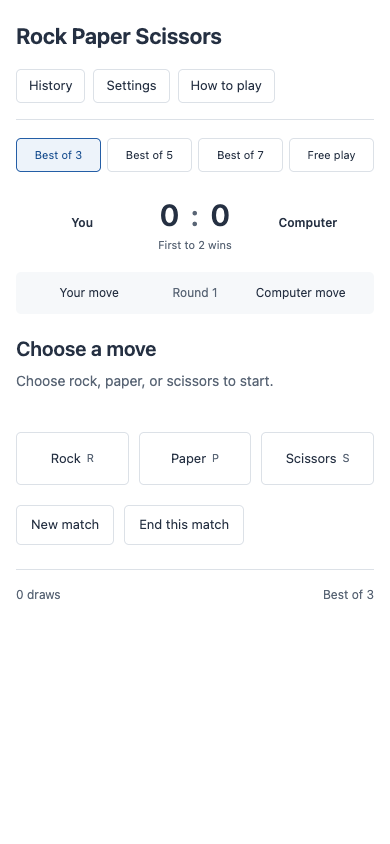

# Rock Paper Scissors

A browser game built with Python and Flask. Play against the computer using a simple interface with text buttons, clear scores, and round results. Choose a match format and keep a local history of finished games.



<details>
<summary>Mobile preview</summary>



</details>

## Run it

Requires **Python 3.10 or newer** and a browser with JavaScript enabled. No frontend build step is needed.

From the repository root, enter the project folder:

```bash
cd 02-rock-paper-scissors
```

On macOS or Linux:

```bash
python3 -m venv .venv
source .venv/bin/activate
python -m pip install -r requirements.txt
python main.py
```

On Windows PowerShell:

```powershell
py -m venv .venv
.venv\Scripts\Activate.ps1
python -m pip install -r requirements.txt
python main.py
```

The launcher opens **http://127.0.0.1:8000**. Keep the terminal running while you play; press `Ctrl+C` there to stop the server. If the browser does not open, enter the address yourself.

## How to play

A new browser session starts a best-of-three match.

1. Choose **Best of 3**, **Best of 5**, **Best of 7**, or **Free play**.
2. Click **Rock**, **Paper**, or **Scissors**, or press `R`, `P`, or `S`.
3. Read the result and updated score. Choose **Play again** after the match ends.

Rock beats scissors, paper beats rock, and scissors beats paper. Matching moves are a draw. For example, choosing rock against scissors wins the round and adds one to your score.

| Format | Finish condition |
| --- | --- |
| Best of 3 | First to 2 wins |
| Best of 5 | First to 3 wins |
| Best of 7 | First to 4 wins |
| Free play | Continue until you choose **Finish & save session** |

Draws do not advance the win target, so a match can take more rounds than its format name suggests.

Use **Settings** to enter a player name of up to 24 characters and start a new match. The browser remembers the name. **History** shows saved results, statistics, and the latest five rounds of the current match. **How to play** opens the rules. Keyboard move shortcuts pause while a dialog is open or an input has focus.

## Saved games

Completed matches save automatically. **End this match** saves a best-of match as unfinished; **Finish & save session** saves a free-play result. Starting a new match or changing format ends the current session, with confirmation if rounds have been played. Empty sessions are not saved.

History shows the latest 50 saved sessions. Statistics cover all saved sessions; match wins and win rate count only completed best-of matches. Free play and unfinished matches are excluded from that rate.

Results are stored in `~/.rps-studio/history.sqlite3`, shared by players using that database. Player names are labels, not accounts. Saved history contains match summaries rather than individual rounds.

Refreshing restores your active match while the server is running. Restarting the server clears active matches but keeps saved history. Closing a tab does not save an unfinished match, and active matches expire after 24 hours of inactivity.

## Launch options

```bash
# Use another port and open the browser yourself
python main.py --port 8080 --no-browser

# Choose a different history database
python main.py --database ./data/history.sqlite3

# Show all options
python main.py --help
```

After installation, `rps` and `python -m rock_paper_scissors` also launch the game and accept the same options.

## How the code works

- `main.py` and `src/rock_paper_scissors/__main__.py` launch the local server.
- `game.py` handles moves, round outcomes, and match rules.
- `web.py` provides Flask routes and holds active matches in memory.
- `storage.py` saves match summaries in SQLite.
- `templates/index.html` and `static/` provide the HTML, CSS, and JavaScript interface.

Python selects the computer's move before the player submits theirs and calculates every result. Match IDs and revisions reject stale turns. The server listens on `127.0.0.1` for local use.

## Checks

From this project folder, with the virtual environment active:

```bash
python -m pip install -e ".[dev]"
python -m unittest discover -s tests -v
ruff check .
ruff format --check .
```

Tests cover game rules, match formats, persistence, validation, session isolation, and error handling. To check the browser interface:

```bash
python -m playwright install chromium
python tests/browser_checks.py
```

Browser checks cover gameplay, replay, history, keyboard input, refresh recovery, mobile layout, and player names. Set `RPS_BROWSER_CHANNEL=chrome` to use installed Chrome, or `RPS_CAPTURE=1` to refresh the README screenshots.

## Troubleshooting

- **Port 8000 is busy:** use `--port 8080` and open the printed address.
- **The page cannot reach the game:** check that the server is still running, then refresh.
- **History cannot load or save:** choose a writable path with `--database`.
- **Flask or the package cannot be imported:** activate the virtual environment and run `python -m pip install -r requirements.txt`.

## Credits

The earlier Tabler icon license is preserved in [LICENSE-TABLER.txt](LICENSE-TABLER.txt).
