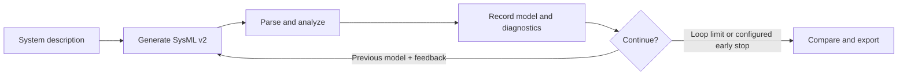
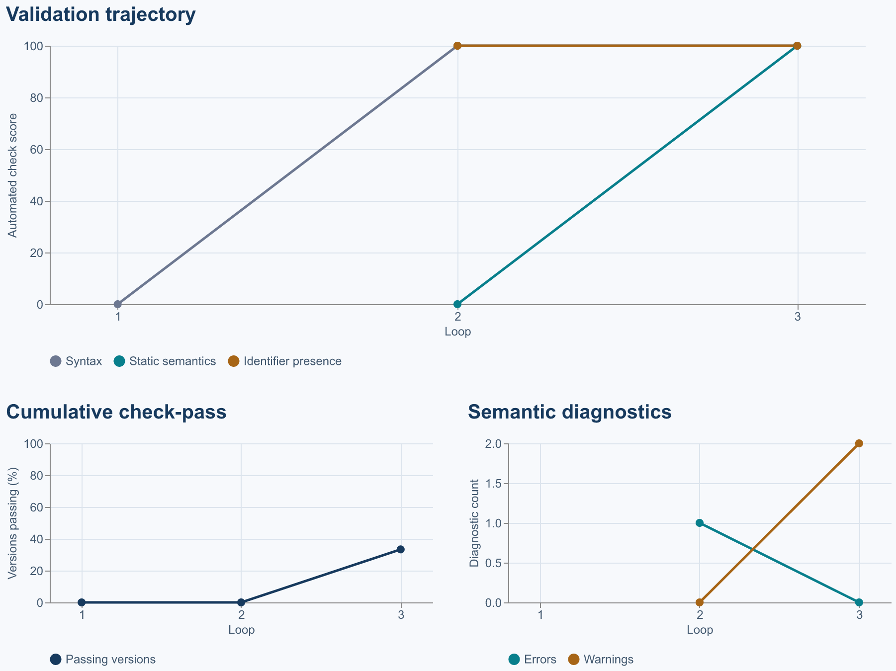

# Agentic MBSE Loop

**An agentic feedback loop for generating and validating textual SysML v2 models.**

Agentic MBSE Loop is a model-based systems engineering (MBSE) prototype that explores whether structured validator feedback can help a language model revise a cyber-physical system model. Starting from a system description, it generates a SysML v2 candidate, checks it with a parser and static analyzer, and returns the diagnostics to the same language model for the next revision. The original description stays fixed so each version can be compared against the same intent.

The application preserves every candidate and its validation results. Its dashboard shows how syntax, static semantics, identifier presence and diagnostics change across iterations, with separate human assessments for architecture and requirements.

## Core workflow



Each revision request contains the original description, the previous candidate and bounded validation feedback. Runs use one selected model and 1–8 loops. Early stopping is optional. A passing version must parse, pass the implemented static checks and contain every configured expected identifier. Unavailable checks remain N/A.

## Sample result

The included [results.json](results.json) is a **recorded offline replay** of three fixed temperature-monitor candidates checked by the installed validator. It illustrates the validation workflow; no language model or API tokens were used in this sample.

| Loop | Syntax | Static semantics | Identifier presence | Semantic errors | Semantic warnings | Automated pass |
| --- | --- | --- | --- | --- | --- | --- |
| 1 | Invalid | N/A | N/A | N/A | N/A | No |
| 2 | Valid | Invalid | 100% | 1 | 0 | No |
| 3 | Valid | Valid | 100% | 0 | 2 | Yes |

Loop 1 is incomplete and fails parsing. Loop 2 parses but references the undefined `MissingController`. Loop 3 passes the configured checks, with two implicit-library-import warnings. The selected model is loop 3; the cumulative check-pass rate is **1/3 (33.3%)**. Architecture and requirement coverage were not reviewed in this record.



The figure is derived directly from the saved measurements. Missing checks appear as gaps rather than zero scores.

## Run locally

Requires **Python 3.11 or newer**.

```bash
cd 25-agentic-mbse-loop
python3 -m venv .venv
source .venv/bin/activate
python -m pip install -r requirements.txt
cp .env.example .env
python main.py
```

On Windows, activate with `.venv\Scripts\activate` and copy `.env.example` to `.env`. Open the local URL printed in the terminal. Stop with Ctrl+C. A different port can be selected with `python main.py --server.port 8502`.

Set `LLM_API_KEY`, `LLM_MODEL` and `LLM_BASE_URL` in `.env` for an OpenAI-compatible Chat Completions provider. The supplied template uses OpenRouter. Credentials can also be entered in the sidebar; a blank key field uses the environment configuration. `.env` is excluded from version control.

Enter the system description, select a loop count and run validation. Advanced settings accept expected identifiers, a custom system prompt, human-review requirements and an output-token budget.

## Results and exports

- **Validation dashboard:** per-loop checks, diagnostics, pass rates and provider-reported token usage.
- **Generated versions:** complete SysML source and diagnostics for every candidate.
- **Engineering review:** independent human assessments supported by model evidence.
- **Provider attempts:** request outcomes, retries and available usage measurements.
- **Downloads:** individual `.sysml` candidates, `best.sysml`, `loop_scores.csv` and `run_record.json`.

The selected best model prioritizes automated passing status, then the internal check-point value and earliest loop. Failed generation slots have no fabricated model or score. Run settings are preserved with the result.

## Implementation

Python and Streamlit provide the interface, Altair renders the charts, an OpenAI-compatible adapter handles generation, and `sysmlpy` supplies the SysML v2 parser and partial static analyzer. Domain logic, validation and human review are separate modules.

```text
app.py                  Run controls, charts, version viewer and review editor
engine.py               Generation loop, provider handling, measurements and exports
validator.py            Parser/analyzer adapter and supplementary model checks
review.py               Evidence-based human assessments
config.py               Provider and environment configuration
main.py                 Local launcher
results.json            Recorded three-loop sample
examples/               SysML models for integration checks
tests/                  Engine, adapter, validator and interface tests
```

See [architecture and measurement definitions](docs/architecture.md) for implementation details.

## Verification

```bash
python -m pip install -r requirements-dev.txt
python -m unittest discover -s tests -v
ruff check .
ruff format --check .
```

`python verify_integration.py --offline` repeats the three-candidate validator check without an API. `python verify_integration.py --live --loops 4` checks the configured provider and requires credentials.

## Scope

The static analyzer implements partial language coverage. Passing checks establishes acceptance by those checks; engineering completeness, requirement satisfaction and system behavior require separate review. Expected-identifier presence is a lexical measure. Human-review results stay N/A until assessed. Provider usage may be unavailable, and API calls depend on the selected provider's availability and pricing.

References: [OMG SysML v2 specification](https://www.omg.org/spec/SysML/2.0), [sysmlpy](https://github.com/mycr0ft/sysmlpy).
